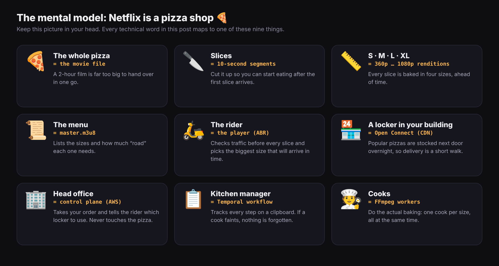
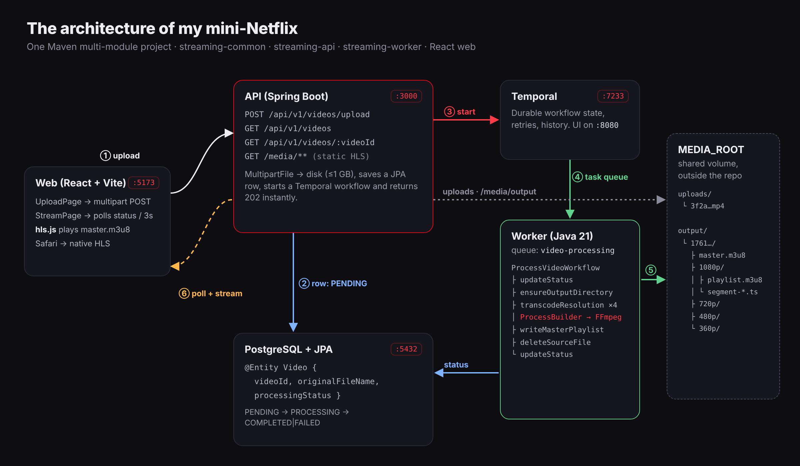
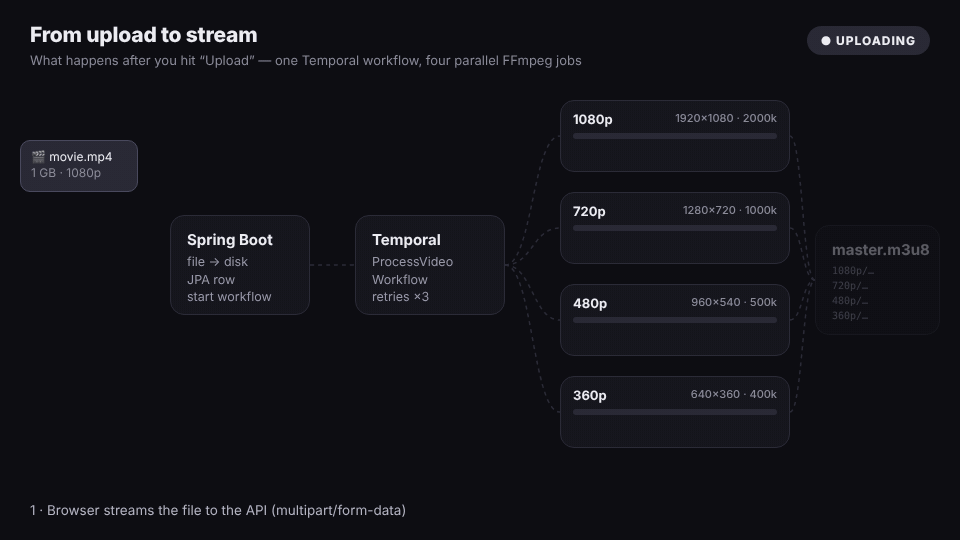
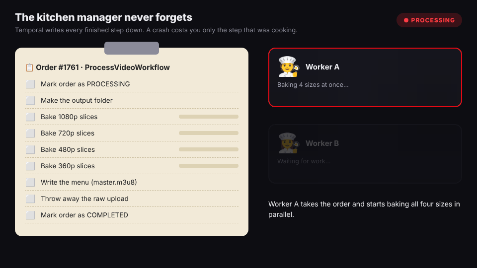

# 🍕 Netflix-style Adaptive Streaming — in Java

A mini-Netflix you can run on your laptop: upload a video, and it gets **baked into 4 qualities, cut into 10-second slices**, and streamed with **adaptive bitrate** (the player picks a quality for every slice based on your network).

**Java 21 · Spring Boot 3 · Temporal · FFmpeg · PostgreSQL · HLS**



## How it works



| Pizza shop | This project |
|---|---|
| 🎬 Counter | `streaming-api` — Spring Boot REST API (upload, status, serves HLS files) |
| 📋 Kitchen manager | Temporal workflow `ProcessVideoWorkflow` (durable, retries, survives crashes) |
| 🧑‍🍳 Cooks | `streaming-worker` — runs FFmpeg for 1080p / 720p / 480p / 360p **in parallel** |
| 📜 Menu | `master.m3u8` — lists every quality |
| 🛵 Rider | hls.js in the browser — picks a quality per slice |



### Why Temporal?

If a worker crashes halfway through, the workflow resumes from its history. Finished renditions are not redone.



## Project layout

```
streaming-common/   bitrate ladder, workflow + activity interfaces, JPA entity, Temporal client
streaming-api/      Spring Boot API on :3000 + a tiny upload/player page at /
streaming-worker/   Spring Boot Temporal worker: ProcessVideoWorkflow + FFmpeg activities
docker/             Postgres + Temporal + Temporal UI
```

## Run it

Requirements: Java 21, Maven, Docker, FFmpeg on your PATH.

```bash
# 1. Infrastructure
docker compose -f docker/docker-compose.yml up -d

# 2. Where uploads and HLS output live
export MEDIA_ROOT=$HOME/netflix-media

# 3. Backend (two terminals)
mvn -pl streaming-api -am spring-boot:run       # http://localhost:3000
mvn -pl streaming-worker -am spring-boot:run
```

Open **http://localhost:3000**, upload a video, and wait for `completed`.
Temporal UI: **http://localhost:8080** (watch the four `transcodeResolution` activities run side by side).

Then open DevTools → Network → throttle to **Slow 4G** and watch the player step down from 1080p to 360p. 🛵

## API

| Method | Path | What it does |
|---|---|---|
| `POST` | `/api/v1/videos/upload` | multipart field `video`; returns `videoId` (202 Accepted) |
| `GET` | `/api/v1/videos/{videoId}` | status + `streamUrl` when completed |
| `GET` | `/api/v1/videos` | list all videos |
| `GET` | `/media/output/{videoId}/master.m3u8` | the HLS stream |

## Ideas for next steps

- Serve segments from S3/R2 + a CDN instead of the API
- Fixed keyframe interval (`-g`, `-sc_threshold 0`) so all renditions cut on the same frame
- Per-title encoding: fewer bits for simple videos
- Report FFmpeg progress through Temporal heartbeats
